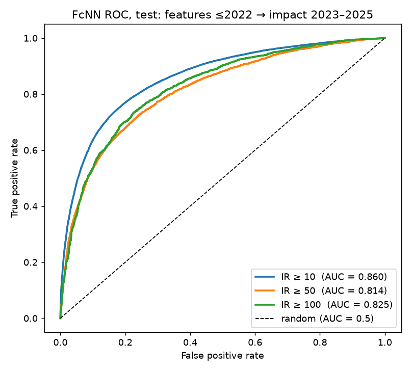
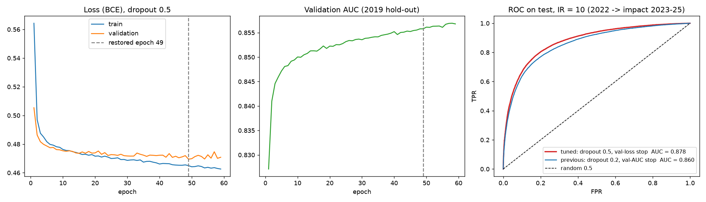
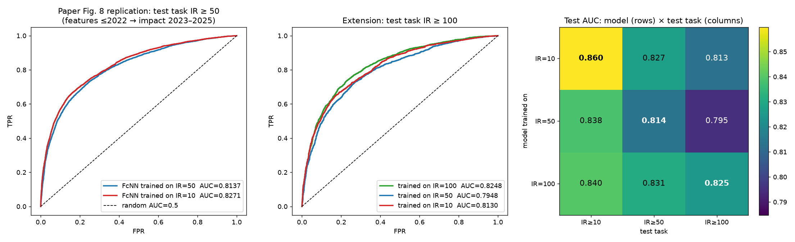

# AI × Quantum convergence: forecasting high-impact research combinations

We apply Gu & Krenn (2024), *Forecasting high-impact research topics via machine learning on evolving knowledge graphs* ([arXiv:2402.08640](https://arxiv.org/abs/2402.08640)), to the convergence of **artificial intelligence and quantum technologies**.

**Question:** given two research keywords that have never appeared together in a paper, will a paper combining them collect ≥ IR citations within the next 3 years?

## Pipeline
```
OpenAlex corpus (30,053 AI × Quantum papers, 2003–2025)
        │
        ▼
feature_pipeline/        knowledge graph of 3,000 keywords → 141 features per unconnected keyword pair
        │                + impact labels IR ≥ 10 / 50 / 100       (train: base year 2019, test: base year 2022)
        ▼
fcnn_ir10/               fully connected NN (4 × 600) for IR ≥ 10            → test AUC 0.860
fcnn_ir10_tuned/         same NN, dropout 0.5 + early stopping on val loss   → test AUC 0.878 (5 seeds: 0.8785 ± 0.0008)
clean_keywords_experiment/  tuned NN on features from a hand-cleaned keyword list → test AUC 0.944 (0.923 on comparable pairs)
fcnn_multi_ir/           the same NN trained and tested for IR ≥ 10, 50, 100 → test AUC 0.860 / 0.814 / 0.825
        │
        ▼
cross_ir_experiment/     replication of the paper's Fig. 8: does a model trained on IR 10 beat one trained on IR 50 at the IR 50 task?
```

| Folder | What it does | Main script |
|---|---|---|
| [`feature_pipeline/`](feature_pipeline) | Extracts yearly citations, builds the evolving keyword graph, computes the paper's **141 features** (Tables I–II: 20 node-network, 58 node-citation, 21 pair-network, 42 pair-citation) and the labels. `scripts/keyword_selection/` shows how the 3,000 keywords were chosen (RAKE + stratum-core's KeyBERT/TF-IDF scorer). | `scripts/2_build_pair_features.py` |
| [`fcnn_ir10/`](fcnn_ir10) | Trains on 2019 pairs (label from 2020–2022) and tests on all 2022 pairs (label from 2023–2025) at IR = 10 | `train_fcnn_ir10.py` |
| [`fcnn_ir10_tuned/`](fcnn_ir10_tuned) | Tunes dropout and the early-stopping rule for IR = 10 (grid, 240 stopping variants, seed check) and trains the final tuned model | `train_fcnn_ir10_tuned.py` |
| [`clean_keywords_experiment/`](clean_keywords_experiment) | Rebuilds the 141 features with a hand-cleaned list of 3,973 keywords and trains the tuned IR-10 model on them, plus a check of how much AUC comes from never-seen keywords | `train_fcnn_ir10_cleankw.py` |
| [`fcnn_multi_ir/`](fcnn_multi_ir) | One model per IR = 10, 50, 100, plus the combined ROC plot | `train_multi_ir.py` |
| [`cross_ir_experiment/`](cross_ir_experiment) | Every IR model scored on every IR test task (paper Fig. 8), with a paired bootstrap of the AUC differences | `cross_ir_eval.py` |

Each folder has its own README with details, how to run it, and results.

## Results (test: features ≤ 2022 → impact 2023–2025)
| | IR ≥ 10 | IR ≥ 50 | IR ≥ 100 |
|---|---|---|---|
| Test AUC | **0.860** | **0.814** | **0.825** |
| Top-100 predicted pairs that really reached the IR | 99% | 98% | 94% |



These three use the original settings (dropout 0.2, early stopping on validation AUC with patience 25).

### Tuned IR = 10 model: 0.860 → 0.878
Changing only two settings raises the IR ≥ 10 test AUC from **0.860 to 0.878**: dropout 0.2 → **0.5**, and early stopping on validation AUC (patience 25) → **validation loss (patience 10)**. The result is stable across training seeds (0.8785 ± 0.0008 over 5 seeds).

| IR ≥ 10, test | Previous | **Tuned** |
|---|---|---|
| AUC | 0.860 | **0.878** |
| Accuracy | 0.785 | 0.801 |
| F1 | 0.781 | 0.803 |

**Why it helps:** the validation set is from 2019, the same year as training, but the test is 2022. Training longer fits 2019-specific patterns. Stronger dropout and stopping on validation loss (which turns up earlier) both stop the model before that happens.

**Caveat:** the setting was identified after seeing test numbers from the tuning run. Choosing by validation AUC alone would have given 0.863. Details are in [`fcnn_ir10_tuned/`](fcnn_ir10_tuned).



### Clean keyword list: 0.878 → 0.944 (0.923 on comparable pairs)
Rebuilding the features with a hand-cleaned list of 3,973 AI × Quantum keywords, and training the same tuned model, gives **test AUC 0.944** for IR ≥ 10.

| IR ≥ 10, test AUC | Top-3000 keywords | **Clean keywords** |
|---|---|---|
| All test pairs | 0.878 | **0.944** |
| Pairs where both keywords have a paper by 2022 | 0.885 | **0.923** |

- **Part of the jump is an easier test set.** 1,051 of the clean keywords never appear in the corpus. 35% of its test pairs contain a keyword with no paper by 2022 (10% for the top-3000 list). Those pairs have almost all-zero features and are mostly negative, so they're easy to rank.
- **On comparable pairs the clean list is still clearly better** (0.923 vs 0.885). We suggest reporting 0.923, or removing unseen keywords before building pairs.

Details are in [`clean_keywords_experiment/`](clean_keywords_experiment).

### Cross-IR experiment (paper Fig. 8)
The paper found that an FcNN trained on IR = 10 slightly beats one trained on IR = 50 at the **IR = 50** task (AUC 0.9416 vs 0.9365). **Our setup replicates this, with a larger gap.**

| Model trained on ↓ / test task → | IR ≥ 10 | IR ≥ 50 | IR ≥ 100 |
|---|---|---|---|
| IR = 10 | **0.860** | 0.827 | 0.813 |
| IR = 50 | 0.838 | 0.814 | 0.795 |
| IR = 100 | 0.840 | **0.831** | **0.825** |

(Bold = best model for each test task.)

- **IR ≥ 50 task:** the IR-10 model scores 0.827 against the IR-50 model's 0.814, a gain of **+0.013** (95% bootstrap CI +0.010 … +0.017).
- **It isn't a general rule.** The IR-100 model also beats the IR-50 model on the IR ≥ 50 task (0.831). On the IR ≥ 100 task, the IR-100 model is best and the IR-10 model is worse (−0.012). The IR-50 model is the weakest on every task, so part of the effect may be this IR-50 training run being weak.
- **Caveat:** each model is a single training run (seed 42). Details are in [`cross_ir_experiment/`](cross_ir_experiment).



## Quick start
```
pip install -r requirements.txt

# 1) features (needs data/ai_quantum_imputed.jsonl in feature_pipeline/data/)
cd feature_pipeline
python scripts/1_extract_citations.py
python scripts/2_build_pair_features.py
python scripts/3_describe_features.py

# 2) models: copy the balanced CSVs into each model's data/ folder:
#    output/pairs_2019/balanced_ir10.csv → balanced_ir10_train.csv
#    output/pairs_2022/balanced_ir10.csv → balanced_ir10_test.csv
cd ../fcnn_ir10 && python train_fcnn_ir10.py
cd ../fcnn_ir10_tuned && python train_fcnn_ir10_tuned.py   # uses ../fcnn_ir10/data
# clean-keyword variant: see clean_keywords_experiment/README.md (2_build_pair_features.py --keywords ... --out ...)
cd ../fcnn_multi_ir && python build_ir_datasets.py && python train_multi_ir.py
cd ../cross_ir_experiment && python cross_ir_eval.py     # uses the models from fcnn_multi_ir
```

## Data not in this repo
- **`ai_quantum_imputed.jsonl`** (585 MB): the OpenAlex corpus with `counts_by_year`.
- **Generated pair datasets:** CSVs of 80–90 MB, and about 1 GB of Parquet.
- **Trained model weights.**
- **The 300 anchor papers file:** it's a Web of Science export and can't be redistributed.
- **The clean keyword list** (`keywords_quantum_ai_clean_final.csv`) used in `clean_keywords_experiment/`.

The repo does include the 3,000 keywords (`feature_pipeline/output/top3000_keywords.csv`) and the feature dictionary.

## Credits
- Method: X. Gu & M. Krenn, *Forecasting high-impact research topics via machine learning on evolving knowledge graphs* (Impact4Cast).
- Keyword scoring: [stratum-core](https://github.com/Krishnakumarbj2004/stratum-core) (`tfidf_keybert.py`, used unmodified).
- Data: [OpenAlex](https://openalex.org).
