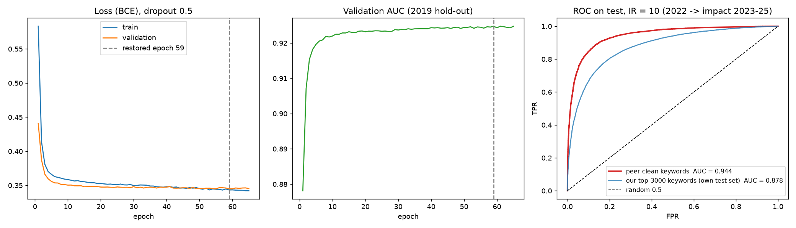

# Clean keyword list: test AUC 0.944 on its own (easier) test set

The same pipeline and model, run on a different vocabulary: a hand-cleaned list of **3,973 AI × Quantum keywords** (`keywords_quantum_ai_clean_final.csv`: 3,628 cleaned from the original extraction plus 345 added terms such as *quantum transformer*, *quantum LSTM*, *quantum k-means*).

## What was done
1. **Features:** `../feature_pipeline/scripts/2_build_pair_features.py` with the clean list (same 141 features and labels, base years 2019 and 2022). It takes about 2.5 min.
2. **Model:** `train_fcnn_ir10_cleankw.py`, identical to the tuned IR-10 model in [`../fcnn_ir10_tuned`](../fcnn_ir10_tuned): dropout 0.5, early stopping on validation loss with patience 10, trained on 2019 and tested on 2022.
3. **Check:** `seen_keywords_check.py` measures how much of the AUC comes from pairs containing a keyword that has no paper by 2022.

## Result
| | Top-3000 keywords (`fcnn_ir10_tuned`) | **Clean keywords** |
|---|---|---|
| Keywords / with ≥ 1 paper by 2022 | 3,000 / 2,828 | 3,973 / 2,579 (1,051 never appear in the corpus) |
| Balanced train / test pairs | 87,272 / 86,316 | 32,866 / 36,431 |
| **Test AUC, all test pairs** | 0.878 | **0.944** |
| **Test AUC, pairs where both keywords have a paper by 2022** | 0.885 | **0.923** |
| Test accuracy / F1 | 0.801 / 0.803 | 0.872 / 0.877 |
| Restored epoch | 49 | 59 |



## Where the improvement comes from: mostly an easier test set
- **Unseen keywords make many test pairs easy.** 35% of the clean-list test pairs contain a keyword with no paper by 2022 (10% for the top-3000 list). Those pairs have almost all-zero features and are mostly negative (only 17% positive), so they're easy to rank. Removing them lowers the AUC from 0.944 to **0.923**.
- **The clean-list test set is easier as a whole.** A paired test in [`../cross_dataset_experiment`](../cross_dataset_experiment) scores both models on both test sets:

  | Model ↓ / test set → | top-3000 test (86k) | clean test (36k) |
  |---|---|---|
  | clean-kw model | 0.852 | 0.944 |
  | top3000 model | **0.878** | 0.931 |

  - The top3000 model, which never saw the clean keywords, already gets 0.931 on the clean test set.
  - On comparable pairs there, the two models are almost equal (0.923 vs 0.920).
  - On the larger top-3000 test set, the clean-kw model is 0.026 *worse*.
  - So the jump to 0.944 doesn't mean the model got better. *(An earlier version of this README called 0.923 vs 0.885 a "real +0.04 gain". That compared two different test sets and is withdrawn.)*
- **The clean-kw model still learned a real, transferable signal:** 0.852 on 86k pairs from a vocabulary it never saw, with 99% of its top-1000 predictions correct.

**Recommendation:** remove keywords with no paper by the training base year before building pairs. Compare models on the same test set: 0.944 and 0.878 come from different test sets and aren't comparable.

## Run
```
# 1) features (needs feature_pipeline/output/_work/papers_citations.parquet from 1_extract_citations.py)
cd ../feature_pipeline
python scripts/2_build_pair_features.py --keywords data/keywords_quantum_ai_clean_final.csv --out ../clean_keywords_experiment/features

# 2) copy the balanced sets into data/
#    features/pairs_2019/balanced_ir10.csv -> data/balanced_ir10_train.csv
#    features/pairs_2022/balanced_ir10.csv -> data/balanced_ir10_test.csv
cd ../clean_keywords_experiment
python train_fcnn_ir10_cleankw.py     # ~3 min CPU
python seen_keywords_check.py         # needs the top-3000 run (feature_pipeline) and fcnn_ir10_tuned predictions for the comparison row
```
The keyword list itself (`keywords_quantum_ai_clean_final.csv`) isn't in this repo; put it in `feature_pipeline/data/`. `--out` keeps these outputs separate from the main top-3000 datasets in `feature_pipeline/output/`.

## Files
- `results/metrics_ir10_cleankw.json`
- `results/training_history_ir10_cleankw.csv`
- `results/fcnn_ir10_cleankw_curves.png`
- `results/seen_keywords_check.json`
- `data/feature_dictionary.csv`

Weights, predictions and the pair datasets aren't versioned.
