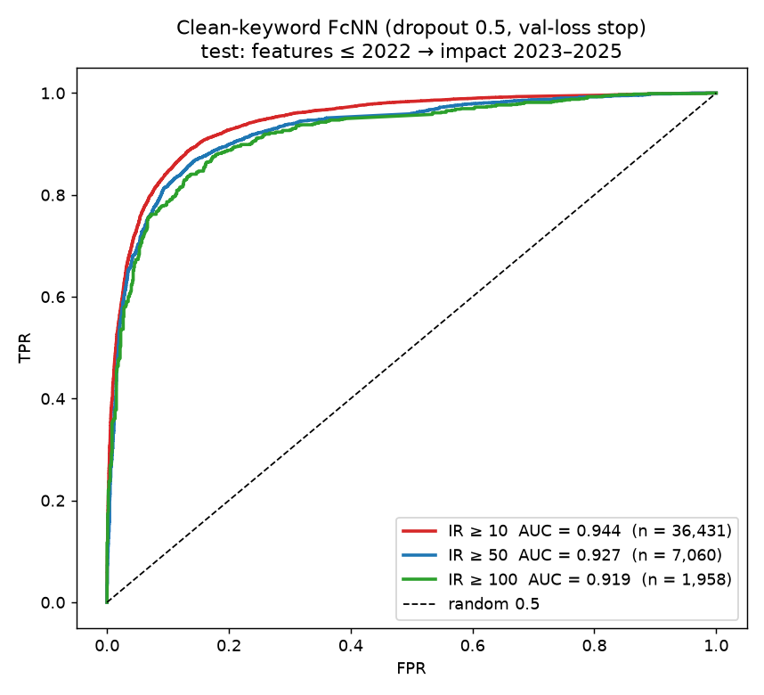

# Clean keywords at IR = 50 and IR = 100

This repeats the clean-keyword experiment ([`../clean_keywords_experiment`](../clean_keywords_experiment), IR = 10) for the higher impact thresholds IR ≥ 50 and IR ≥ 100.

## What was done
1. **Datasets** (`build_ir_datasets_cleankw.py`): from the clean-keyword features (3,973 keywords), all pairs with impact ≥ IR plus an equal number of random pairs below IR, the same recipe as [`../fcnn_multi_ir`](../fcnn_multi_ir). Train uses base year 2019 (label 2020–22); test uses base year 2022 (label 2023–25).
2. **Models** (`train_multi_ir_cleankw.py`): the tuned settings from [`../fcnn_ir10_tuned`](../fcnn_ir10_tuned), meaning dropout 0.5 and early stopping on validation loss with patience 10. Each set is small (the IR 100 test set has 1,958 pairs), so every model was trained with **5 seeds**.
   - **Control:** the same tuned settings on the top-3000 IR 50 / 100 datasets. The original [`../fcnn_multi_ir`](../fcnn_multi_ir) models used dropout 0.2.
3. **Cross-dataset check** (`cross_dataset_ir50_100.py`): each model scored on both vocabularies' test sets, with a paired bootstrap, as in [`../cross_dataset_experiment`](../cross_dataset_experiment).

## Results
| | Clean IR ≥ 50 | Clean IR ≥ 100 |
|---|---|---|
| Train / test pairs | 8,620 / 7,060 | 3,454 / 1,958 |
| **Test AUC (seed 42)** | **0.927** (95% CI 0.920–0.933) | **0.919** (95% CI 0.907–0.931) |
| Test AUC, mean ± sd over 5 seeds | 0.925 ± 0.003 | 0.922 ± 0.002 |
| Test AUC, pairs where both keywords have a paper by 2022 | 0.919 | 0.913 |
| Accuracy / F1 | 0.861 / 0.862 | 0.848 / 0.848 |
| Top-100 predictions correct | 100% | 100% |

On the clean vocabulary, IR 10 / 50 / 100 give test AUC **0.944 / 0.927 / 0.919**.



### Tuned settings on the top-3000 datasets (control)
| | IR ≥ 50 | IR ≥ 100 |
|---|---|---|
| Original model (dropout 0.2, stop on validation AUC) | 0.814 | 0.825 |
| **Tuned (dropout 0.5, stop on validation loss)**, seed 42 | **0.839** | **0.838** |
| Tuned, mean ± sd over 5 seeds | 0.842 ± 0.002 | 0.837 ± 0.003 |

The IR-10 tuning also helps at IR 50 (+0.028) and IR 100 (+0.012), comparing the 5-seed means with the original models.

### Cross-dataset check: is the clean-keyword test set easier?
| IR | Model ↓ / test set → | clean test | top-3000 test |
|---|---|---|---|
| 50 | clean-keyword model | **0.927** | 0.791 |
| 50 | top-3000 model | 0.909 | **0.839** |
| 100 | clean-keyword model | **0.919** | 0.770 |
| 100 | top-3000 model | 0.897 | **0.838** |

Paired differences (clean − top-3000 model):
- **IR 50:** +0.018 on the clean test (CI +0.014 … +0.022); −0.049 on the top-3000 test (CI −0.052 … −0.045).
- **IR 100:** +0.022 on the clean test (CI +0.012 … +0.033); −0.069 on the top-3000 test (CI −0.077 … −0.061).

## Conclusions
1. **On its own data the clean vocabulary gives high AUCs at every threshold:** 0.944 / 0.927 / 0.919. They're stable across seeds, and the top-100 predictions are all correct.
2. **As at IR 10, much of that comes from an easier test set.** The top-3000 model, never trained on clean keywords, already reaches 0.909 and 0.897 there. 39% of the clean IR 50 / 100 test pairs contain a keyword with no paper by 2022.
3. **The clean-keyword models transfer worse than at IR 10.** On the top-3000 test sets they drop to 0.791 and 0.770, below the top-3000 models (0.839 and 0.838). With only 8.6k / 3.5k training pairs they fit their own vocabulary more narrowly.
4. **Each model is best on its own vocabulary.** Only compare AUCs on the same test set.

## Run
```
# needs ../clean_keywords_experiment/features (see that README) and ../fcnn_multi_ir/data
python build_ir_datasets_cleankw.py     # writes data/balanced_ir{50,100}_{train,test}.csv
python train_multi_ir_cleankw.py        # 20 trainings (2 vocabularies × 2 IR × 5 seeds), ~30 min CPU
python cross_dataset_ir50_100.py        # ~1 min
```

## Files in `results/`
- `summary_ir50_100.csv`: seed-42 AUC with CI, 5-seed mean ± sd
- `{clean,top3000}_ir{50,100}/`: metrics JSON and training history. The weights and per-pair test predictions are created when you run the script and aren't versioned.
- `cross_dataset_ir50_100.{csv,json}`
- `roc_cleankw_ir10_50_100.png`
