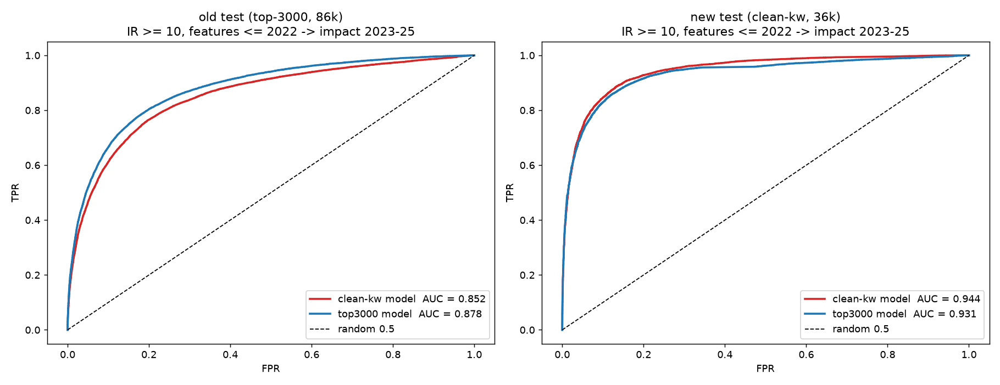

# Cross-dataset evaluation: does the 0.944 clean-keyword model hold up on the larger 86k test set?

**Models:** both are tuned IR-10 FcNNs (dropout 0.5, early stopping on validation loss with patience 10, seed 42), trained on 2019:
- **clean-kw model:** trained on the clean-keyword features (33k rows).
- **top3000 model:** trained on our top-3000 features (87k rows).

**Test sets:** both use base year 2022 (impact 2023–2025):
- **old test:** top-3000 keywords, 86,316 pairs.
- **new test:** clean keywords, 36,431 pairs.

The 141 features don't depend on which words the keywords are (degrees, citations, ranks, similarity indices), so either model can score either test set. Each model uses its own scaler. The paired bootstrap uses 2,000 resamples.

| Model ↓ / test set → | **old test (86k)** | new test (36k) |
|---|---|---|
| clean-kw model | **0.852** | **0.944** |
| top3000 model | **0.878** | 0.931 |
| Difference (clean − top3000), 95% CI | −0.026 (−0.027 … −0.025) | +0.012 (+0.011 … +0.014) |
| AUC, both keywords seen by 2022: clean / top3000 | 0.870 / 0.885 | 0.923 / 0.920 |

On the old test set, the clean-kw model has accuracy 0.711, precision 0.650, recall 0.913, and 98% / 99% of its top-100 / top-1000 predictions are correct.



## Findings
1. **The clean-kw model learned a real, transferable signal.** On 86k pairs from a vocabulary it never saw, it reaches AUC 0.852, and 99% of its top-1000 predictions are correct.
2. **It isn't better than the top3000 model.** On the old test set it's 0.026 lower. On its own test set it's only 0.012 higher. Each model is best on data from its own vocabulary, a mild domain shift.
3. **The 0.944 comes mostly from the easier test set, not from a better model.** The top3000 model, which never saw clean keywords, already gets 0.931 on the new test set. On comparable pairs (both keywords seen) the two models are almost equal there (0.923 vs 0.920).
   - This corrects the earlier reading ("+0.04 real gain from clean keywords"). That figure compared two different test sets.
4. **The clean-kw model's 0.5 threshold doesn't transfer.** On the old set it predicts too many positives (recall 0.91, precision 0.65, accuracy 0.71), because the top-3000 graph is denser (higher degrees and citations per keyword). AUC and the top-k ranking are unaffected; a threshold would need recalibrating.

## Run
Train `../fcnn_ir10_tuned` and `../clean_keywords_experiment` first. This script needs:
- their `.pt` models
- their test CSVs: `../fcnn_ir10/data/balanced_ir10_test.csv` and `../clean_keywords_experiment/data/balanced_ir10_test.csv`
- the two keyword-incidence matrices (`feature_pipeline/output/_work/` and `clean_keywords_experiment/features/_work/`)
```
python cross_dataset_eval.py      # ~1 min CPU
```

## Files
- `cross_dataset_eval.py`
- `results/cross_dataset_results.csv`
- `results/cross_dataset_results.json` (includes the bootstrap)
- `results/cross_dataset_roc.png`
